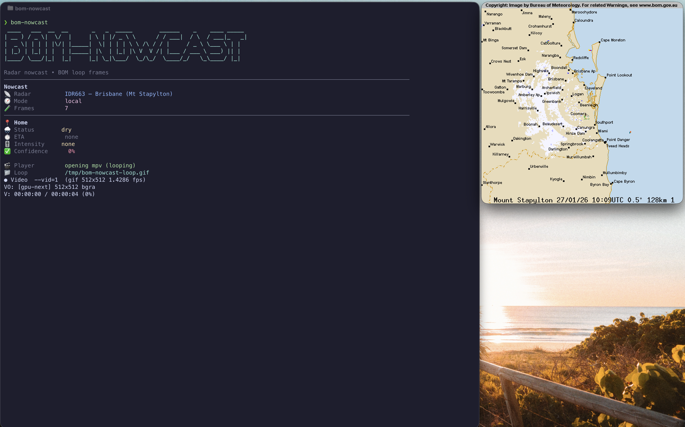

# bom-nowcast

Fast Australian Bureau of Meteorology (BOM) radar CLI. Pull up a live radar loop and rain ETA from your terminal or desktop hotkey in a fraction of a second.

Avoids BOM FTP (which regularly hangs) and scrapes BOM HTTPS loop pages with keep-alive pooling, parallel downloads, native-zlib PNG decoding, and cached loop rendering.



## Highlights

- **Fast hotkey launch**: single scrape, parallel frame/overlay/emoji downloads, cached composite frames and GIFs, and instant repeat runs (~110 ms warm).
- **Rain nowcast**: multi-frame motion tracking using actual UTC frame timestamps, 60-minute colored terminal rain sparkline, ETA window, intensity + trend (`building`/`easing`), storm speed/direction, clear-time estimate when raining, and nearest-rain distance when dry.
- **Readable loops with projected forecast**: map background, place labels, Twemoji pins, crisp local-time pill (`12:44 PM NOW`), bottom timeline bar, and `+10m / +20m / +30m` advected forecast frames when rain is moving on the radar.
- **Noctalia Shell + desktop alerts**: includes a native Noctalia v5 Luau bar widget under `integrations/noctalia/` plus `prefetch --noctalia` / `--notify` for rain alerts and background cache warming.
- **Hyprland side-by-side ready**: `mpv` launches with `--wayland-app-id=org.tongy.bom-nowcast-radar` so the CLI window (`org.tongy.bom-nowcast`) and radar loop sit side-by-side without overlapping.
- **Zero extra dependencies**: uses Node.js built-ins alongside `commander` and `pngjs`, with `ffmpeg`, ImageMagick (`magick`/`convert`), or a built-in JS GIF encoder as fallback.

## Prerequisites

- Node.js 20+
- `mpv` (optional, recommended for default loop playback)
- `ffmpeg` or ImageMagick (`magick` / `convert`) (optional, faster GIF encoding; falls back to a built-in JS GIF encoder)

## Install

```bash
npm install
npm link
```

Or run directly with `node bom-nowcast.js ...`.

## Quick start

```bash
bom-nowcast setup
bom-nowcast
```

Config lives at `~/.config/bom-nowcast/config.json`. Cache lives under `~/.cache/bom-nowcast/`.

## Instant desktop hotkey + Noctalia Shell integration

Running `bom-nowcast` with no arguments prints the nowcast (with 60-minute rain bar) and opens the radar loop in `mpv` with `--wayland-app-id=org.tongy.bom-nowcast-radar` (distinct from Ghostty's `org.tongy.bom-nowcast` so Hyprland can place CLI and radar side-by-side).

A native Noctalia Shell v5 bar widget lives in `integrations/noctalia/`. It polls `bom-nowcast prefetch --noctalia` every 5 minutes to show live rain ETA in the bar, keep the radar GIF warm for ~110 ms hotkey launches, and push native Noctalia alerts when rain approaches within 30 minutes.

## Commands

### Default run (nowcast + `mpv` loop)

```bash
bom-nowcast
bom-nowcast --fresh        # bypass short scrape/render cache
bom-nowcast --no-forecast  # skip projected +10/+20/+30m frames
bom-nowcast --no-player    # print nowcast and build GIF without opening mpv
```

### Nowcast

```bash
# Default location
bom-nowcast nowcast --frames 7 --mode local

# Named location or all locations
bom-nowcast nowcast --location Work
bom-nowcast nowcast --all

# Explicit coordinates, JSON, or Noctalia payload
bom-nowcast nowcast --lat -27.874798 --lon 153.296172 --json
bom-nowcast nowcast --noctalia
```

### Loop GIF

```bash
bom-nowcast loop --radar IDR664 --frames 7 --out /tmp/bom-nowcast-loop.gif
bom-nowcast loop --delay 500 --hold 1500 --no-forecast
```

### Fetch and prefetch

```bash
bom-nowcast fetch --radar IDR664 --frames 10
bom-nowcast prefetch --noctalia
bom-nowcast prefetch --notify --threshold-min 30 --cooldown-min 45
```

### Locations and setup

```bash
bom-nowcast setup
bom-nowcast config-init
bom-nowcast locations
bom-nowcast location-add --name Work --lat -27.4705 --lon 153.0260 --emoji 🏢
bom-nowcast location-add --name Home --lat -27.8748 --lon 153.2962 --set-default
bom-nowcast location-remove --name Work
bom-nowcast radars
```

## Testing

```bash
npm test
```

## References

- BOM loop pages: https://reg.bom.gov.au/products/
- BOM radar transparencies: https://reg.bom.gov.au/products/radar_transparencies/
